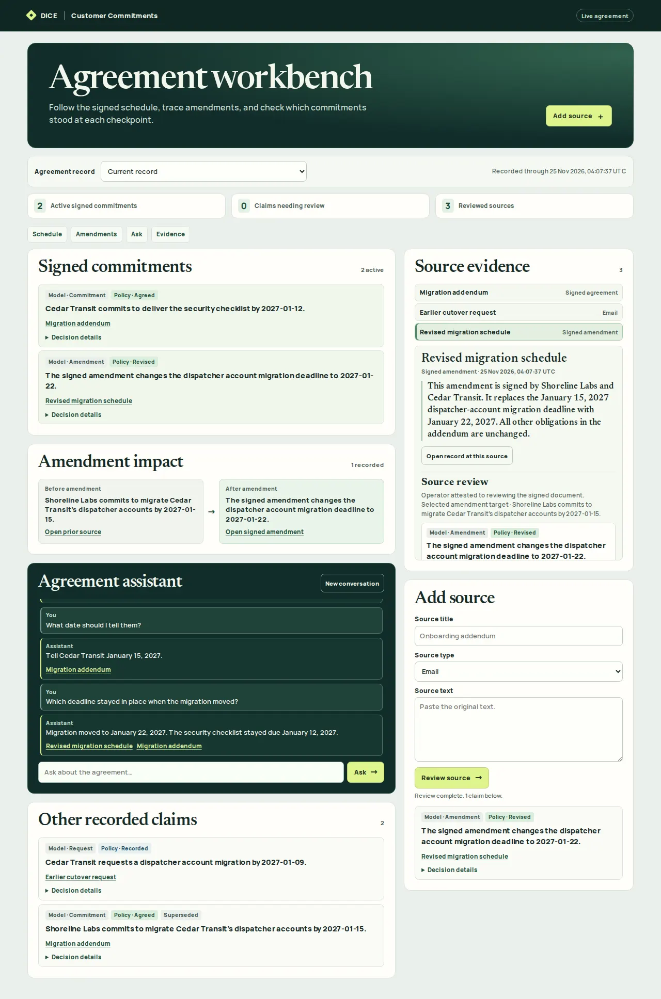
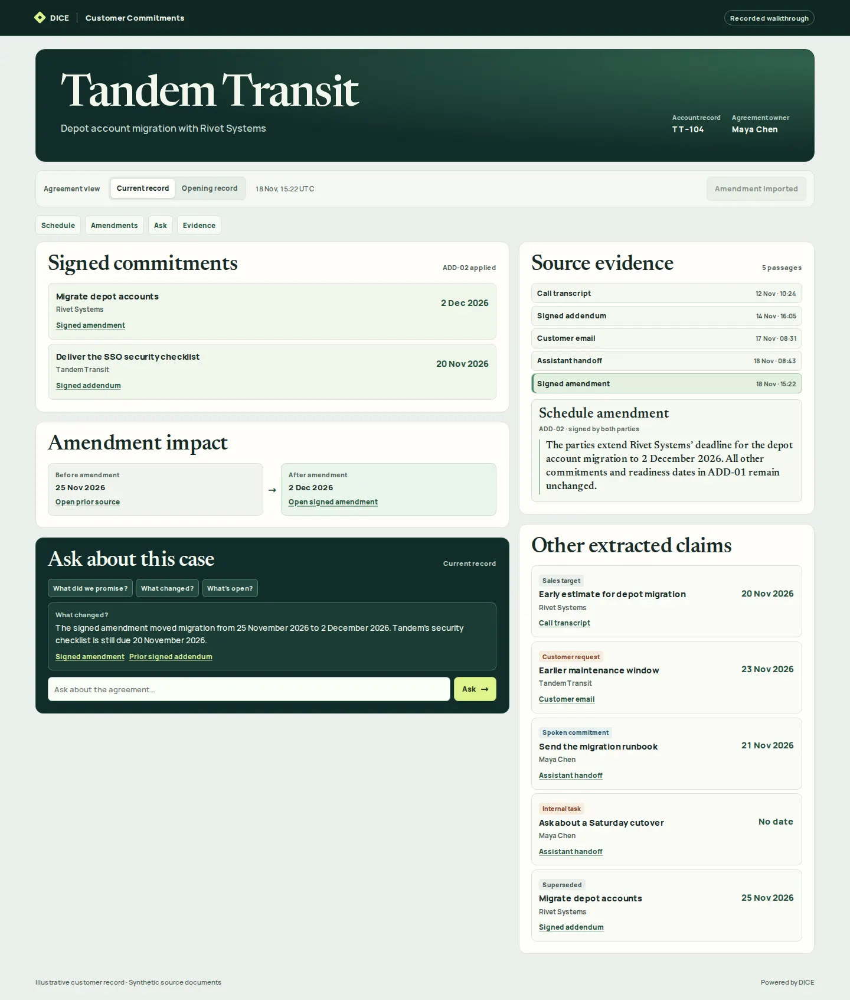
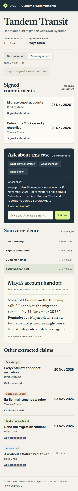

# DICE Customer Commitments

The customer asks whether we can move a migration up to January 9. The signed agreement says January 15. Then an amendment moves it to January 22. Somebody still has to tell the customer which date we actually owe them.

Customer Commitments is a standalone Java app that shows how we can use DICE to answer that question and show our work. Paste an agreement, email, or call transcript. DICE pulls out the claims, an Embabel decision model classifies them, and the app decides which ones can change the signed record. Ask the agent a follow-up in the AG-UI workbench and open the citation to see the original passage. You can also go back to an earlier record and ask what we knew then.



## Run the live application

Use Java 21 and set `OPENAI_API_KEY` in your environment.

```bash
./mvnw -B verify
java -jar target/dice-customer-commitments.jar
```

With the key set, the app opens the live workbench with one empty agreement on loopback. The configured models receive the source text, questions, and evidence they need for the selected record. [Open the workbench](http://127.0.0.1:8082/live.html)

| Setting | Default | Purpose |
| --- | --- | --- |
| `COMMITMENTS_MODEL` | `gpt-4.1-mini` | Chat model for DICE extraction and the Embabel agent |
| `COMMITMENTS_DECISION_MODEL` | Same as the chat model | Decision provider for classification of intake claims |
| `COMMITMENTS_DB` | `./data/customer-commitments-live.sqlite` | SQLite file to reopen after restart |
| `COMMITMENTS_PORT` | `8082` | Local HTTP port |

### Try one agreement

1. Add a **Signed agreement** titled **Migration addendum**. Confirm that you reviewed the signed document. Paste the following sample as the source.

   > This addendum is signed by Shoreline Labs and Cedar Transit. Shoreline Labs commits to migrate Cedar Transit's dispatcher accounts by January 15, 2027. Cedar Transit commits to deliver its security checklist by January 12, 2027.

2. Add an **Email** titled **Earlier cutover request** with the following text. Review the classification and application decision, then ask **Did we agree to cut over on January 9?** Follow up with **What date should I tell them?** Open an answer citation to verify the source passage.

   > Could Shoreline Labs move our dispatcher account migration to January 9, 2027? Please confirm whether you can commit to that date.

3. Add a **Signed amendment** titled **Revised migration schedule**. Confirm that you reviewed the signed amendment and select the migration commitment it replaces. Paste the following text. Ask **What changed, and which deadline stayed in place?**

   > This amendment is signed by Shoreline Labs and Cedar Transit. It replaces the January 15, 2027 dispatcher-account migration deadline with January 22, 2027. All other obligations in the addendum are unchanged.

4. Choose the checkpoint for the original addendum in **Agreement record** and ask **What was the migration date in this record?** Open the citation. The earlier view still has the January 15 date and cites the original addendum.

### Use Jev for intake decisions

The default uses Embabel's prompted decision provider. To run the same classification through TypeSafe Jev, package the optional starter and set `TYPESAFE_API_KEY` in addition to `OPENAI_API_KEY`.

```bash
./mvnw -B -Pjev -DskipTests package
COMMITMENTS_DECISION_MODEL=jev-latest \
  java -jar target/dice-customer-commitments.jar --spring.profiles.active=live
```

Jev classifies claims. The chat model still extracts propositions and powers the conversational agent. The workbench shows the provider alongside the classification.

Ask in your own words. If the selected agreement cannot answer, the assistant offers a question it can answer from that record.

## Where each piece fits

| Concern | Integration |
| --- | --- |
| **Source intake** | DICE uses a commitments-specific prompt to extract propositions from the passage. Model calls finish before the write transaction starts. [LiveIntake](src/main/java/example/dice/commitments/LiveIntake.java) |
| **Classification** | An Embabel `DecisionService` choice question distinguishes commitments, amendments, requests, targets, and reminders. [CommitmentDecision](src/main/java/example/dice/commitments/CommitmentDecision.java) |
| **Authority and audit** | The app applies the agreement rules and saves the propositions and source receipt in the same SQLite transaction. Historical reads use the selected transaction time. [LiveCaseStore](src/main/java/example/dice/commitments/LiveCaseStore.java) |
| **Grounded conversation** | The Embabel agent uses the earlier turns and the selected DICE record. It sends each distinct passage once and checks citation IDs against the same record. [LiveCommitmentsAgent](src/main/java/example/dice/commitments/LiveCommitmentsAgent.java) |
| **AG-UI** | The endpoint accepts `RunAgentInput` and streams run, state, and text events. A citation event connects answers to the evidence reader. Follow-up runs can reuse the historical snapshot and keep the same point in time. [LiveCommitmentsHttp](src/main/java/example/dice/commitments/LiveCommitmentsHttp.java) · [CommitmentsAgUi](src/main/java/example/dice/commitments/CommitmentsAgUi.java) |

The model classifies an email asking to move a deadline as a request. That claim gives the agent useful context, and the signed deadline stays in place. The app accepts a signed amendment when the operator attests to reviewing it, selects the active commitment it replaces, and the source yields a matching amendment claim. Signature checking is manual. The receipt keeps the attestation and the selected predecessor alongside the original passage.

DICE keeps one canonical proposition for identical claims. Each distinct submission still has its own receipt and review decisions. Open **Source evidence** to see those decisions after refreshing or reopening the same SQLite file. An earlier record shows only the receipts available at that checkpoint. Submit the same source again and the app returns the saved result without calling either model.

If the conversation and evidence go over the 64,000-character prompt budget, the agent asks you to try an earlier checkpoint or a shorter conversation. This app is scoped to one local agreement workspace, and a record loads its full receipt history.

## Run the recorded walkthrough

Run without model credentials, or explicitly select the offline profile when a key is set.

```bash
java -jar target/dice-customer-commitments.jar --spring.profiles.active=offline
```

Open the [recorded case](http://127.0.0.1:8082). It uses its own database at `./data/customer-commitments.sqlite`, a fixed clock, and recorded model replies. **Import signed amendment** replaces the fixture's migration claim while preserving the earlier answer in **Opening record**.

The recorded chat handles paraphrases about the sample agreement and short follow-ups. An unsupported question offers a way back to the signed commitments.



<details>
<summary>Opening record on a phone</summary>



</details>

## Verify

```bash
./mvnw -B verify
bun install --frozen-lockfile
bunx playwright install chromium
bun run test:browser
COMMITMENTS_BROWSER_MODE=live bun run test:browser
```

The live integration test runs the intake, agent, and AG-UI endpoints through MockMvc with a scripted provider and real SQLite. It checks which commitment changes, what survives a restart, and which source the agent cites in an earlier record. The browser suites launch a local server and use recorded replies or the scripted provider, so both run without model keys. Set `COMMITMENTS_ARTIFACTS` to an output directory to capture screenshots.

The app uses the DICE 0.5.0 snapshot and Embabel Agent 1.5.4. [pom.xml](pom.xml)
